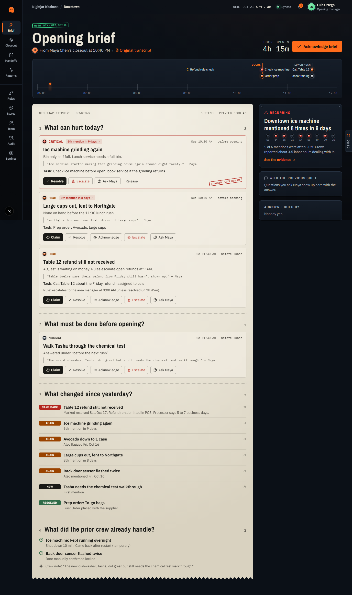
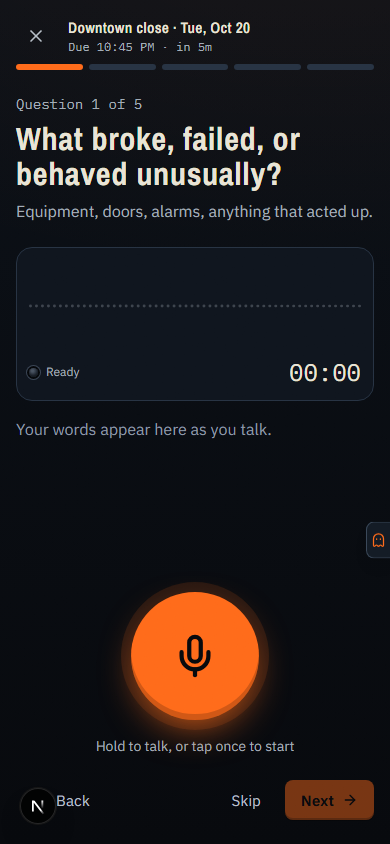
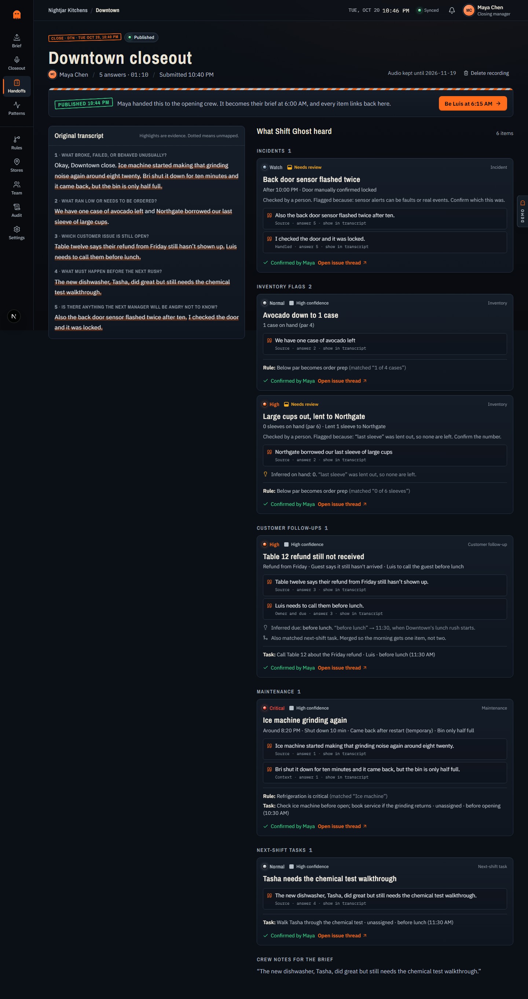
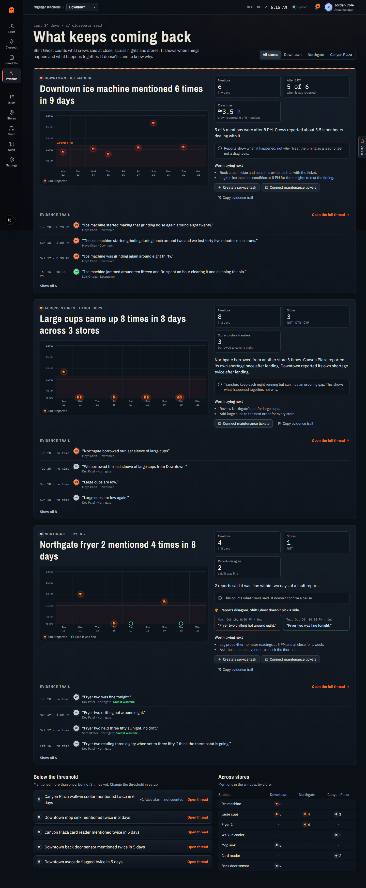
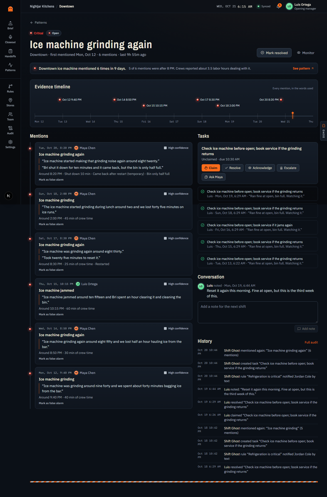

# Shift Ghost

**A voice-first shift handoff.** A tired closing manager answers five questions in about two minutes. Shift Ghost turns that into tomorrow's prioritized opening brief: every item tied to the sentence it came from, anything uncertain held for a person to confirm, and problems that keep coming back across shifts and stores surfaced with their evidence.

Demo company: **Nightjar Kitchens**, a fictional three-store fast-casual group (Downtown, Northgate, Canyon Plaza). All data is seeded and runs in the browser. No accounts, no paid APIs, no external services.



---

## Run it

```bash
npm install
npm run dev
```

Open http://localhost:3000 and press **Start the four-minute demo**.

| Command | What it does |
| --- | --- |
| `npm run dev` | Dev server |
| `npm run build && npm start` | Production build |
| `npm test` | 50 unit tests (extraction fixtures, rules, deduplication, patterns, briefing, conflicts, undo) |
| `npm run test:e2e` | Playwright: the full acceptance journey, safeguards, and an axe WCAG 2.1 AA scan of every story screen. Starts its own server on :3210, or set `E2E_BASE_URL` to reuse one |
| `npm run lint` · `npm run typecheck` | ESLint, TypeScript |
| `npm run remotion:studio` | Open the explainer in Remotion Studio |
| `npm run remotion:render` | Render `out/shift-ghost-explainer.mp4` (1920×1080, 30 fps, 45 s) |
| `npm run remotion:render:vertical` | Render the 1080×1920 variant with the same props |

First-time Playwright setup: `npx playwright install chromium`.

### Reset the demo

Open **Demo controls** (the tab on the right edge of every screen) → **Reset all demo data**. That restores nine nights of history, tonight's closeout not yet submitted, 10:40 PM Tuesday. Clearing the site's local storage does the same.

---

## The four-minute demo script

| # | Step | Where | What to point at |
| --- | --- | --- | --- |
| 1 | **Configure Nightjar Kitchens** | *Start the four-minute demo* → `/setup` (as Jordan, area manager) | Shift-line diagram, the five closeout questions, rules with plain-language summaries, a real brief preview. Skippable and resumable. |
| 2 | **Submit tonight's closeout** | `/capture` as Maya | Hold-to-talk (or tap), live waveform, timer, pause, five-question progress. *Demo shortcut* fills Maya's five answers. |
| 3 | **Confirm or correct** | `/handoffs/:id` | The transcript turns into items; each lifts out of its sentence. Two items wait for a person: cups at **0** was *inferred*, the door sensor could be a fault or a real event. Publishing asks before it texts Jordan about the critical ice machine. |
| 4 | **Switch to Luis next morning** | *Be Luis at 6:15 AM* | The brief answers four questions: what can hurt today, what must be done before opening, what changed since yesterday, what the prior crew already handled. |
| 5 | **Claim the refund call and the ice machine** | `/briefing` | Optimistic claim with stamp and undo. The refund shows its 9:00 AM escalation rule. |
| 6 | **Discover the recurring problem** | *6th mention in 9 days* → `/patterns` | Downtown ice machine: 6 mentions in 9 days, 5 of 6 after 8 PM, ≈3.5 crew-reported labor hours. Correlation language only. Fryer reports that disagree sit side by side; a false alarm is shown but not counted. |
| 7 | **Play the explainer** | `/explainer` | The Remotion composition playing live in the page, 16:9 or 9:16. |

Optional beats: **Demo controls** → *A teammate edits the same task* (conflict dialog), *Offline mode* (queued capture with unsynced count), *Next extraction fails* (error state with the transcript kept), *Inject a closeout* (an unsure Northgate closer with *uncertain* items), *Jump to 9:01 AM* (the refund rule fires). View as **Bri** and open Rules to see the permission screen.

---

## Architecture

```
src/
  domain/                 Pure TypeScript. No React.
    types.ts              Organizations, locations, users/roles, shift templates & instances,
                          closeout questions, handoffs (recordings/transcripts), extracted items,
                          evidence spans, tasks, issues, incidents, inventory flags, escalation
                          rules, acknowledgments, comments, notifications, audit events
    extraction/           Deterministic extractor: segmentation, spoken numbers and times,
                          lexicon, coreference, clause splitting, confidence, deduplication
    rules/evaluate.ts     Rule matching, time-based rules, plain-language summaries
    commands.ts           Every state change: (draft db, input, ctx) → touched records + audit
    briefing.ts           Composes the four-question opening brief
    patterns.ts           Recurring-problem detection across shifts and stores
    schemas.ts            Zod schemas for every form
  data/
    seed.ts               Base company + nine nights replayed through the real engine
    transcripts.ts        Zod-validated seed and sample transcripts (incl. the brief's primary one)
    adapter.ts            DataAdapter interface + localStorage implementation
  store/                  Zustand store: optimistic dispatch, undo, offline outbox, conflicts
  components/             UI by area (capture, review, briefing, patterns, rules, ops, demo)
  app/                    Next.js App Router routes
remotion/                 ShiftGhostExplainer compositions (shares /public with the app)
e2e/                      Playwright journeys, safeguards, accessibility and screenshot sweep
```

**How a closeout flows.** `createHandoff` stores the answers and joined transcript → `processHandoff` runs the extractor and rules, producing *proposed* items with evidence spans → the reviewer confirms, corrects or dismisses anything below *high* confidence (publishing is blocked until they do) → `publishHandoff` attaches each item to a persistent issue thread, creates one task per issue (repeat mentions merge into the open task), aggregates order prep, sends rule notifications, and schedules the brief → `composeBriefing` and `detectPatterns` derive the morning view.

**Swapping in real services.** The boundaries are explicit:

- `Extractor` (`src/domain/extraction/extract.ts`): replace the rule-based extractor with an LLM call that returns the same `DraftItem` shape, evidence offsets included.
- `DataAdapter` (`src/data/adapter.ts`): replace localStorage with Supabase/Postgres. Each command in `commands.ts` maps to one API mutation; the audit table is append-only.
- Transcription: `useRecorder` already captures real audio with MediaRecorder; *Transcribe my own words* uses the browser's speech service. A server-side speech-to-text provider slots in where the simulated transcript is produced.
- Connectors (Settings → *Where briefs and tickets go*) show the exact payloads for team chat, maintenance tickets, inventory orders and scheduling.

Consequential choices and their reasons are in [DECISIONS.md](DECISIONS.md). Progress is tracked in [BUILD_STATUS.md](BUILD_STATUS.md). The commercial story is in [SALES_HANDOFF.md](SALES_HANDOFF.md). The original brief is [01-shift-ghost.md](01-shift-ghost.md).

---

## What is real and what is simulated

| Real (runs in this demo) | Simulated (behind a clean boundary) |
| --- | --- |
| Extraction with evidence spans, inferences, confidence language, deduplication, unmapped tray | Speech-to-text: the mic waveform is live, the words come from Maya's script unless you opt into the browser speech service |
| Review gate, corrections, dismissals, critical-publish confirmation | SMS, push, email and team-chat delivery (they land in the in-app notification list) |
| Rules: mentions, below par, open-at-time escalation, plain-language summaries, test panel | Integrations (payload previews and a delivery log, no outbound calls) |
| Pattern detection, contradictions, false-alarm exclusion, crew-time totals | Other people's actions (Maya's reply to a question, a teammate's conflicting claim) |
| Offline queue, cross-tab conflicts via entity versions, undo, append-only audit trail, CSV export | Server latency (a short, visible processing step) |

The in-app browser preview blocks the microphone; recording then falls back to a simulated waveform. In a normal browser the waveform follows your voice and you can play each answer back.

---

## Screenshots

Captured by `SCREENS=1 npx playwright test e2e/screens.spec.ts` into `docs/screenshots/` at 390, 768, 1440 and 2560 px:

| | |
| --- | --- |
|  |  |
|  |  |

Screens worth capturing for a portfolio: the capture question on a phone, the review mid-transformation, the brief with one claim stamped, the ice machine pattern grid, the fryer contradiction, the rules test panel, the permission screen as Bri, and offline mode.

---

## Quality checks

- Responsive at 390, 768, 1440 and 2560 px with no horizontal page scroll (checked with the screenshot sweep).
- Keyboard: every action is a button or link; the record button toggles with Enter/Space; dialogs trap focus (Radix).
- Accessibility: axe WCAG 2.1 AA scan of landing, setup, capture, review, briefing, patterns and rules, with no serious or critical violations.
- Motion respects `prefers-reduced-motion` (the transformation is skipped and pulses stop).
- Skeletons match final layout while local data loads, so nothing jumps.
- No secrets: the repo has no keys, tokens or environment files.
